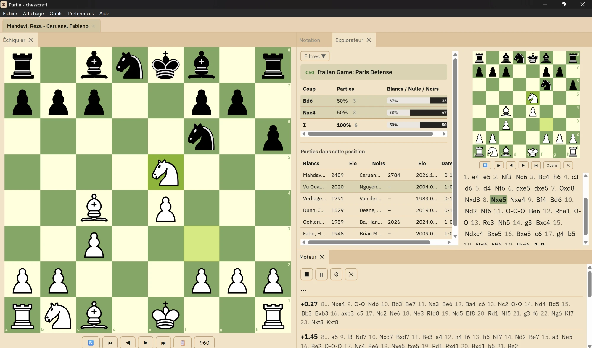

# ChessCraft

Gestionnaire de parties d'échecs pour Windows : des bases de plusieurs millions de parties, un explorateur d'ouvertures, l'analyse avec Stockfish et la préparation d'adversaire, le tout en local sur votre ordinateur. Gratuit, sans compte en ligne ni abonnement.



## Fonctionnalités

- **Bases de parties** : import de PGN en masse et des comptes Lichess et chess.com, base de référence tenue à jour depuis TWIC et les retransmissions Lichess (revue tournoi par tournoi avant chaque import, doublons écartés).
- **Explorateur d'ouvertures** : résultats Blancs / nulle / Noirs, code ECO, filtres par joueur, classement et année. La recherche par position retrouve aussi les transpositions, y compris en Chess960.
- **Analyse avec Stockfish** : jusqu'à 10 lignes en parallèle, profondeur libre, aperçu de la position au survol de chaque coup. Le rapport de partie calcule précision, gaffes et courbe d'évaluation.
- **Mode entraînement** : rejouer une partie en cherchant les coups, avec précision en direct et résumé de séance.
- **Annotation complète** : variantes, commentaires, les 165 symboles NAG, diagrammes et citations d'autres parties, enregistrés en PGN standard.
- **Joueurs FIDE** : liste FIDE locale pour unifier les noms à l'import, performance Elo d'une sélection, préparation d'adversaire par couleur, fiche FIDE en un clic.
- Et aussi : Chess960, éditeur de position et FEN, pendules lues dans le PGN, thèmes clair et sombre, raccourcis clavier, interface en français et en anglais.

## Télécharger

Dernière version : **[page des versions](https://github.com/chessdeveb/chesscraft/releases/latest)**, fichier `.msi`.

- **Système** : Windows 10 ou 11, 64 bits.
- **Moteur d'analyse** : Stockfish n'est pas inclus. Téléchargez-le sur [stockfishchess.org](https://stockfishchess.org/download/), puis indiquez son emplacement dans le panneau Moteur.
- **Mises à jour** : une fois installé, ChessCraft se met à jour de lui-même (Aide › À propos).
- **Avertissement Windows** : l'installateur n'est pas signé par un certificat d'éditeur. Windows SmartScreen peut afficher « Windows a protégé votre ordinateur » : cliquez sur « Informations complémentaires », puis « Exécuter quand même ».

## Compiler depuis les sources

ChessCraft est une application [Tauri 2](https://tauri.app/) : interface en React + TypeScript (Vite), moteur en Rust avec SQLite.

Prérequis :

- [Node.js](https://nodejs.org/) (version LTS récente) ;
- [Rust](https://www.rust-lang.org/tools/install) stable ;
- les [prérequis Tauri pour Windows](https://tauri.app/start/prerequisites/) (outils de compilation Microsoft C++ et WebView2).

```bash
npm install
npm run tauri dev      # lance l'application en mode développement
npm run tauri build    # produit l'installateur dans src-tauri/target/release/bundle/msi
```

Tests et vérifications :

```bash
cd src-tauri && cargo test --lib   # tests du moteur Rust
npx tsc --noEmit                   # vérification des types de l'interface
```

Un `npm run tauri build` sans clé de signature produit un installateur utilisable, mais sans fichiers de mise à jour automatique signés : seules les versions publiées ici les fournissent.

## Organisation du code

| Dossier | Contenu |
|---|---|
| `src/` | Interface React : fenêtres Accueil et Partie, panneaux (`DockPanels.tsx`, `HomeDockPanels.tsx`), composants dans `components/`, traductions dans `locales/` |
| `src-tauri/src/` | Moteur Rust : bases SQLite (`db.rs`), index des positions par empreinte de Zobrist (`explorer.rs`), PGN (`pgn.rs`, `game_tree.rs`), Stockfish via UCI (`engine.rs`), liste FIDE (`fide.rs`), imports Lichess, chess.com et TWIC |
| `src-tauri/resources/` | Référentiel des ouvertures ECO |

## Licence

ChessCraft est un logiciel libre : vous pouvez le redistribuer et le modifier selon les termes de la licence publique générale GNU (GPL), version 3 ou toute version ultérieure. Voir [LICENSE](LICENSE) pour le texte complet.

Cette licence découle des bibliothèques au cœur de l'application, elles-mêmes sous GPL-3.0-or-later : [`shakmaty`](https://github.com/niklasf/shakmaty) et [`pgn-reader`](https://github.com/niklasf/pgn-reader) (règles des échecs et lecture des PGN, côté Rust) et [`@lichess-org/chessground`](https://github.com/lichess-org/chessground) (échiquier, côté interface).

Ressources tierces :

- pièces « cburnett » de Colin M.L. Burnett, fournies avec chessground ;
- noms et codes d'ouvertures issus de [lichess-org/chess-openings](https://github.com/lichess-org/chess-openings) (CC0) ;
- polices [IBM Plex](https://github.com/IBM/plex) (SIL Open Font License 1.1).
